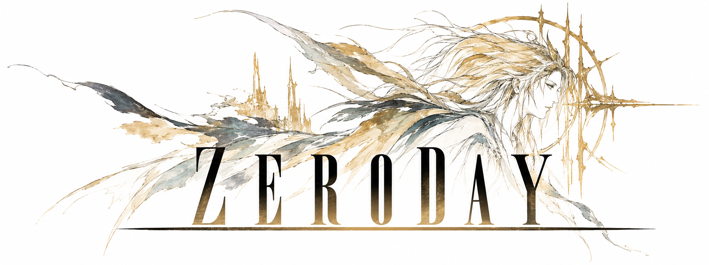

<p align="center">
  
</p>

<p align="center">
  <strong>A Steam mod for Linux and Steam Deck.</strong>
</p>

<p align="center">
  <a href="https://github.com/YAHUkhannan/zeroday/releases/latest">Download</a>
  &nbsp;·&nbsp;
  <a href="docs/INSTALL.md">Installation guide</a>
  &nbsp;·&nbsp;
  <a href="https://github.com/YAHUkhannan/zeroday/issues">Report an issue</a>
</p>

## Install

Open a terminal in Desktop Mode and run:

```sh
curl -fsSL https://github.com/YAHUkhannan/zeroday/releases/latest/download/install.sh | bash
```

Choose **Install**. The installer handles setup and restarts Steam when it is
finished. Existing settings, keys and ticket cache are preserved.

**Requires:** Linux x86-64, Python 3, curl and an installed Steam client.
Pillow enables the artwork; a text interface is available without it.

Compatible Steam installations are kept unchanged. When Steam needs an update,
the installer checks the available build and updates automatically if it is
supported. An unsupported update offers **Update Steam anyway** or **Cancel**;
updating anyway leaves ZeroDay disabled.

## Included

- Steam library and download integration, with an optional Decky plugin.
- Cached launch tickets with background refresh.
- Steam Deck support in Desktop Mode and Game Mode.
- An animated installer with menu sounds, launcher repair and recovery on failure.

## Latest release

[**ZeroDay v1.2.0**](https://github.com/YAHUkhannan/zeroday/releases/latest)
adds Steam compatibility checks and supported automatic updates, and includes
the latest native reload safeguard. Steam build **1792618285** is validated;
the installer checks the actual native client and interface files.

## Documentation

[Install, update and remove](docs/INSTALL.md)
&nbsp;·&nbsp;
[Troubleshooting](docs/TROUBLESHOOTING.md)
&nbsp;·&nbsp;
[Build the installer](docs/DEVELOPMENT.md)
